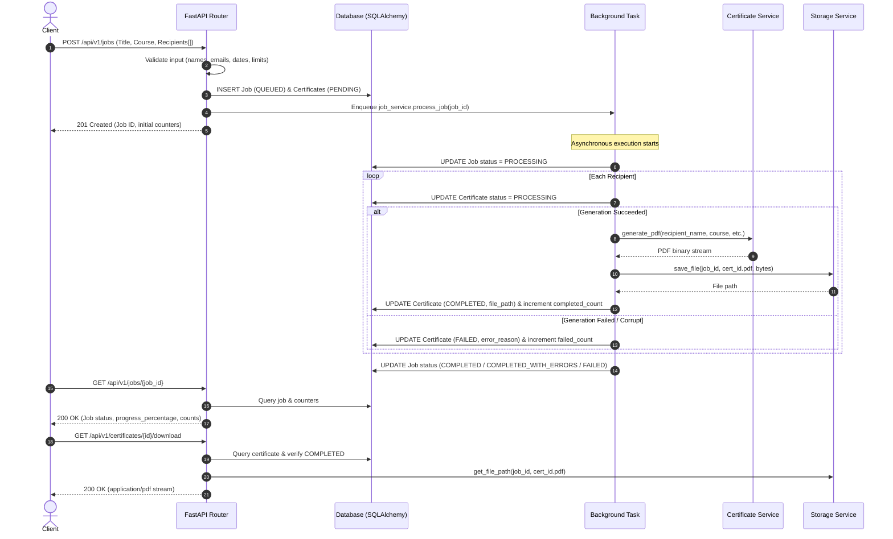
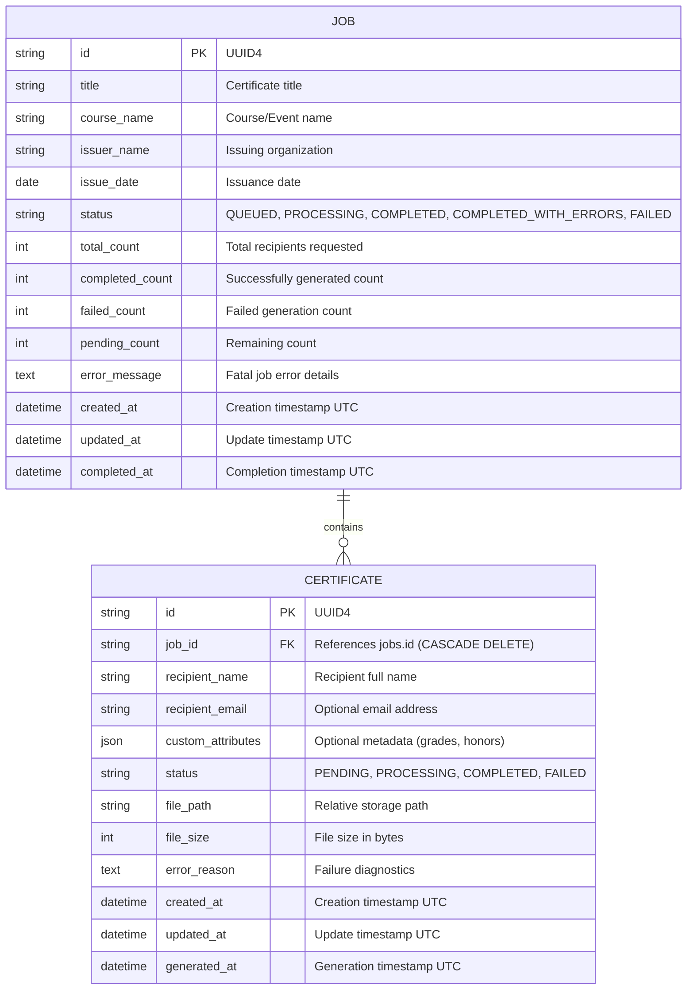
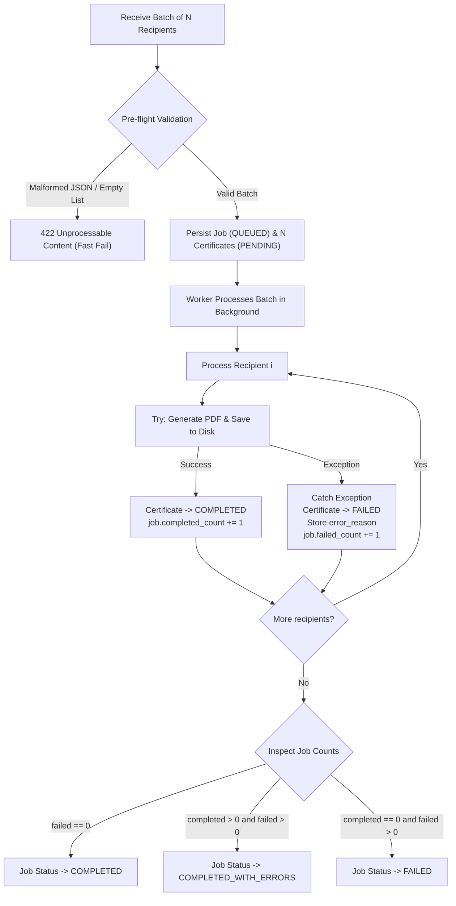

# Bulk Certificate Generator — Architecture & System Design

## 1. System Overview

The **Bulk Certificate Generator** is an asynchronous backend service engineered to process batch certificate generation requests reliably. The architecture separates client request handling from compute-heavy PDF generation while isolating failures at the individual recipient level.

```mermaid
graph TD
    Client["Client / API Consumer"] -->|POST /api/v1/jobs| API["FastAPI Route Layer (app/api/routes)"]
    API -->|Validate Schema| Pydantic["Pydantic Schemas (app/schemas)"]
    API -->|Create Records| JobService["Job Service (app/services/job_service.py)"]
    JobService -->|Persist Job & Certs| DB[(Relational DB: SQLite / Postgres)]
    API -->|Enqueue Task| BG["FastAPI BackgroundTasks"]
    API -->|HTTP 201 Created| Client

    BG -->|Execute Async| Worker["Job Worker (process_job)"]
    Worker -->|Fetch Pending Certs| DB
    loop For Each Recipient
        Worker -->|Render Vector PDF| CertService["Certificate Service (ReportLab)"]
        CertService -->|Raw PDF Bytes| Worker
        Worker -->|Persist File| StorageService["Storage Service (LocalStorage)"]
        StorageService -->|Save .pdf| Disk["Secure Disk Storage"]
        Worker -->|Update Status (COMPLETED / FAILED)| DB
    end
    Worker -->|Update Final Job Status| DB

    Client -->|GET /api/v1/jobs/{id}| API
    Client -->|GET /api/v1/certificates/{id}/download| API
    API -->|Stream PDF File| Client
```

---

## 2. Request & Execution Lifecycle



---

## 3. Database Entity-Relationship Diagram



---

## 4. Failure Handling & Isolation Flow



---

## 5. Architectural & Design Decisions

### 5.1 Asynchronous Background Processing
- **Decision:** Utilize FastAPI's native `BackgroundTasks` executing in a managed threadpool.
- **Rationale:** The assignment specifies keeping the infrastructure lean without over-engineering (no Redis, Celery, or RabbitMQ). FastAPI's `BackgroundTasks` allows immediate HTTP 201 response times while processing PDF rendering in the background.
- **Trade-off / Limitations:** Background tasks share the web process memory space. If the server process is forcefully terminated mid-flight, unfinished in-memory tasks would need resumption logic. For multi-node horizontal scaling, a distributed message broker (Celery + Redis/RabbitMQ) would be the next step.

### 5.2 Storage Service Abstraction (`BaseStorageService`)
- **Decision:** Encapsulate disk I/O behind an abstract base class `BaseStorageService` with a concrete `LocalStorageService`.
- **Rationale:** Prevents route handlers from directly manipulating filesystems. Guarantees strict directory traversal prevention (`..` and separator checks) while providing a pluggable interface for future Amazon S3 or Google Cloud Storage backends.

### 5.3 Deterministic Progress Tracking
- **Decision:** Store explicit counters (`total_count`, `completed_count`, `failed_count`, `pending_count`) on the `Job` model and dynamically compute `progress_percentage`.
- **Rationale:** Polling clients can query progress with a single fast `O(1)` index-assisted primary key lookup on the `jobs` table without performing costly `COUNT(*)` aggregates across thousands of certificates on every poll.
